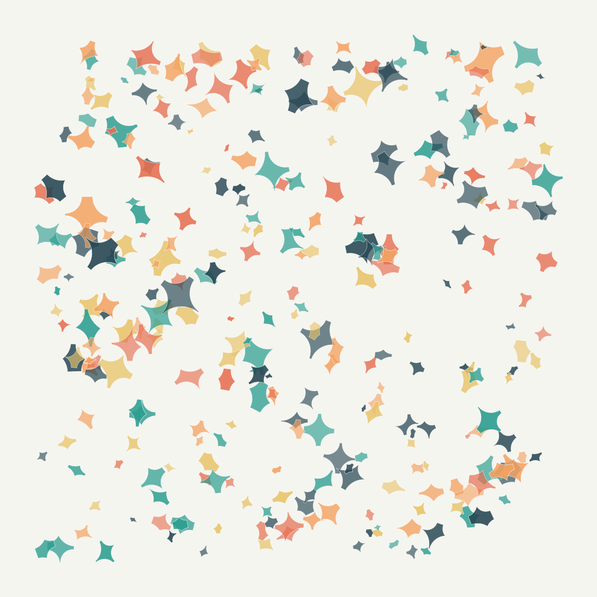
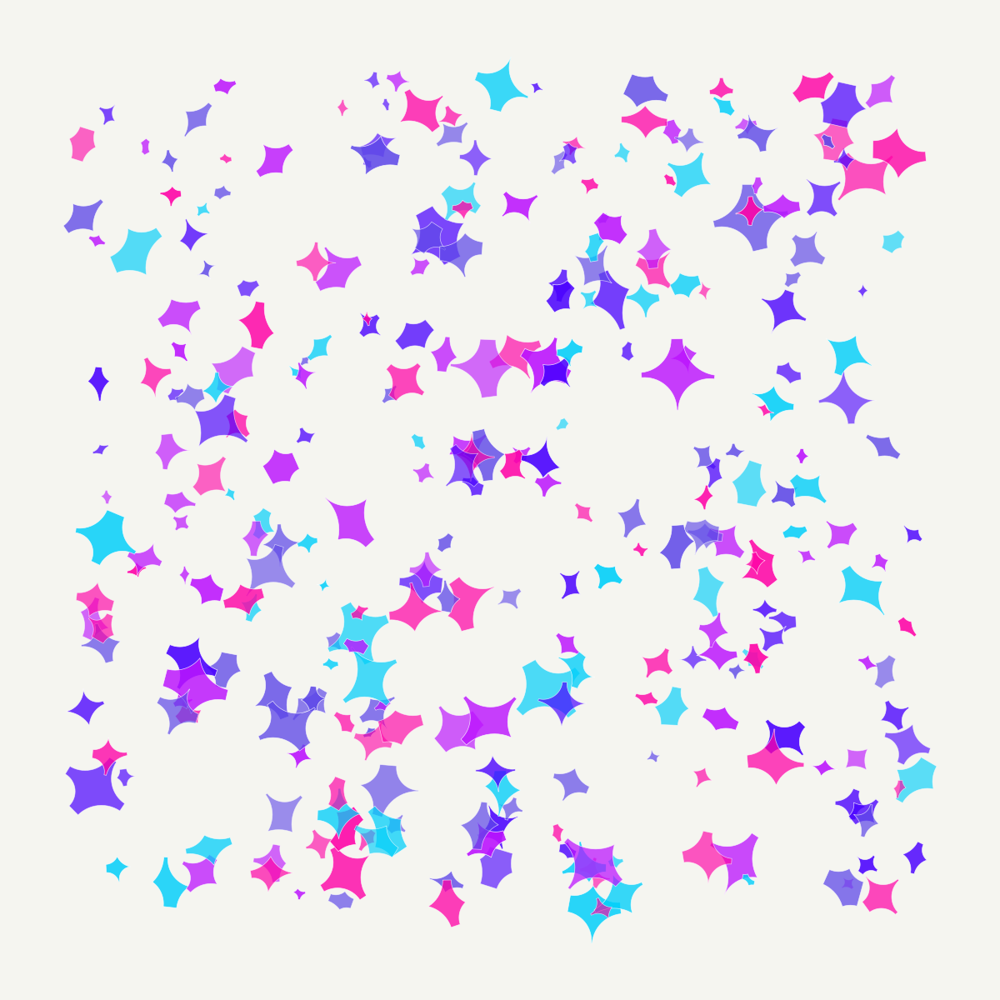
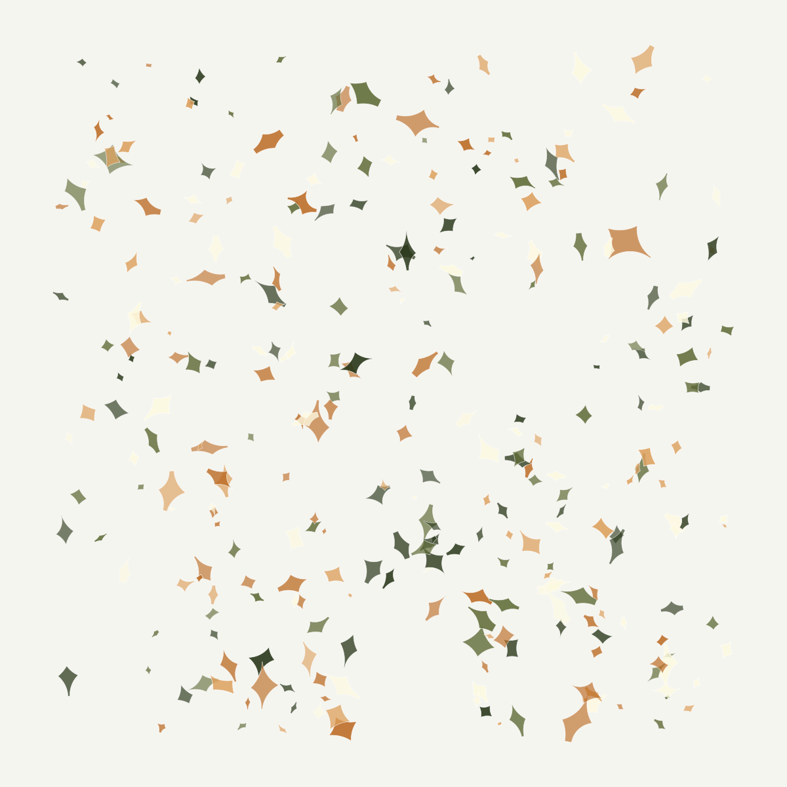
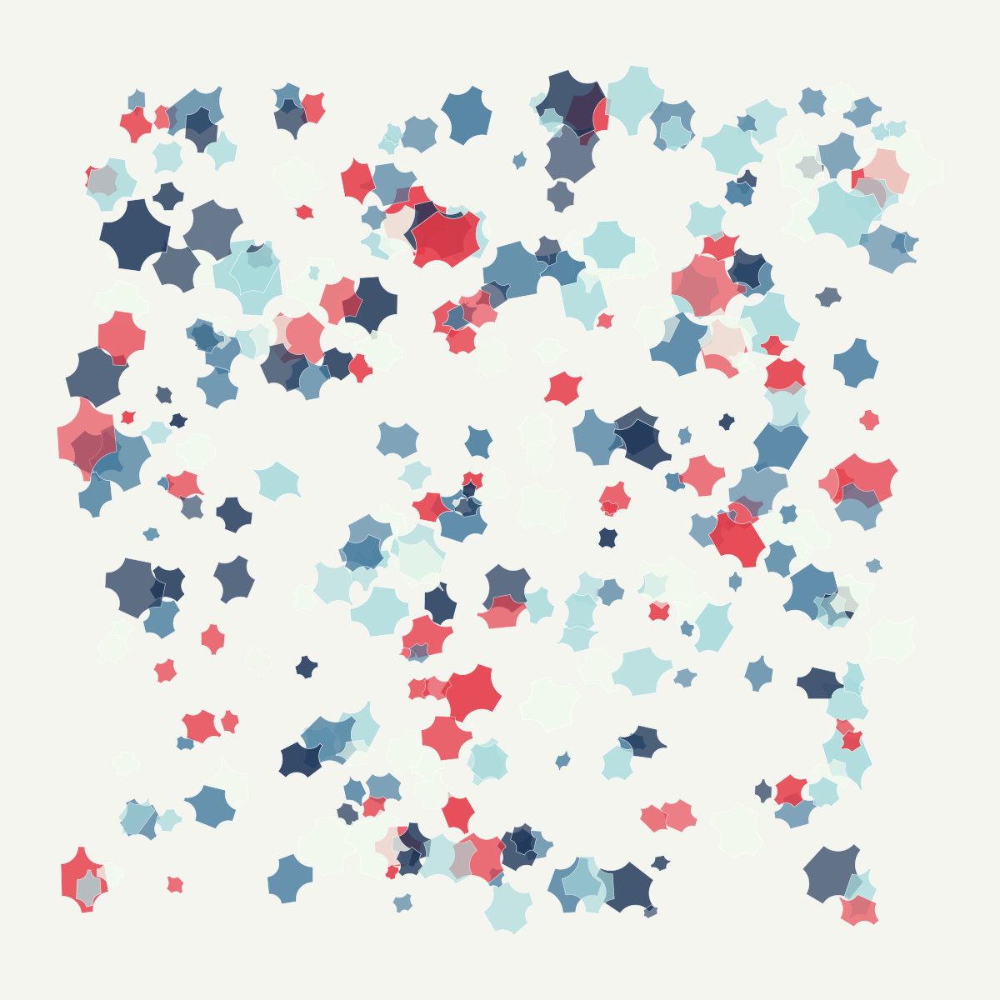

# confetti-generator

Generative art by subtraction: each *confetto* is a near-rectangular quadrilateral minus the union of the circles centred on its vertices.

| | |
|---|---|
|  |  |
|  |  |

## How it works

1. **Quadrilateral.** Start from a random rectangle and perturb each vertex along two directions. Moving a vertex along its diagonal leaves the angles unchanged. Moving it perpendicular to the diagonal changes them, so that component is capped to keep every angle between 80° and 100°. Then rotate the shape at random and place it on the canvas.
2. **Circles.** Centre a circle on each vertex. Its radius is a random fraction (`r_min`–`r_max`) of the vertex's distance from the centre of the shape.
3. **Subtraction.** confetto = quadrilateral − ⋃ circles (computed with [Shapely](https://shapely.readthedocs.io/)).

Repeat this a few hundred times with random positions, sizes, colours and transparency.

## Installation

```bash
git clone https://github.com/telecalifornia/confetti-generator.git
cd confetti-generator
pip install -r requirements.txt
```

## Usage

```bash
python confetti_generator.py                                  # show on screen
python confetti_generator.py -o artwork.png                   # save to file
python confetti_generator.py -p vaporwave -s 42 -o art.png    # palette + seed
python confetti_generator.py -o art.svg                       # vector output
python confetti_generator.py --list-palettes
```

| Option | Default | Description |
|---|---|---|
| `-n`, `--num` | 300 | number of confetti |
| `--r-min` | 0.55 | lower radius bound (fraction of vertex distance) |
| `--r-max` | 0.80 | upper radius bound |
| `-p`, `--palette` | `bauhaus` | `bauhaus`, `bauhaus-classic`, `industrial`, `vaporwave`, `arid` |
| `-s`, `--seed` | random | the same seed gives the same image |
| `-o`, `--output` | — | output file (`.png`, `.svg`, `.pdf`…) |
| `--dpi` | 200 | resolution for raster formats |

### Shaping the confetti with `r_min` / `r_max`

| `r_min` – `r_max` | Result |
|---|---|
| 0.40 – 0.95 | very variable shapes |
| 0.55 – 0.80 | balanced (default) |
| 0.60 – 0.70 | almost constant, very geometric |
| 0.70 – 0.90 | large circles → thin, spiky shapes |
| 0.40 – 0.55 | small circles → full, compact shapes |

You can also use it as a module:

```python
from confetti_generator import render_artwork
render_artwork(500, r_min=0.6, r_max=0.7, palette="industrial", seed=1, output="out.png")
```

## License

- **Code:** [MIT](LICENSE) © 2026 Vincenzo Iannone
- **Images** in `examples/`: [CC BY-NC 4.0](https://creativecommons.org/licenses/by-nc/4.0/)
